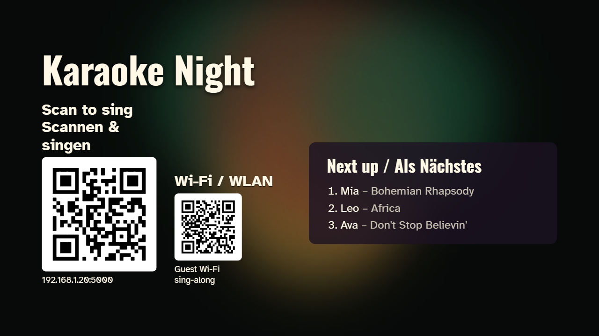
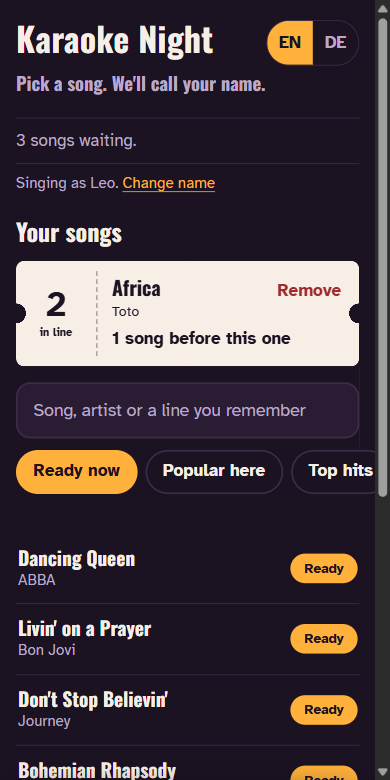
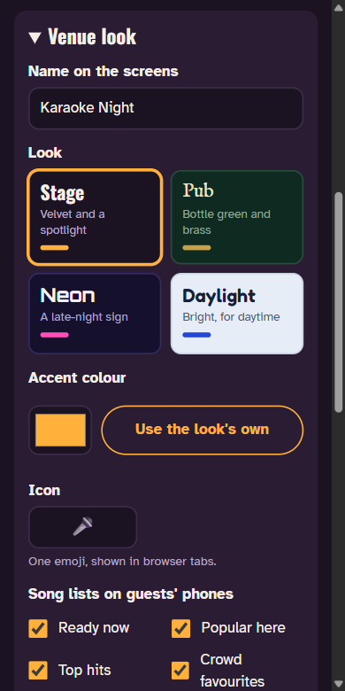
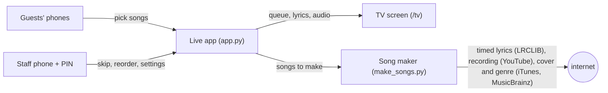
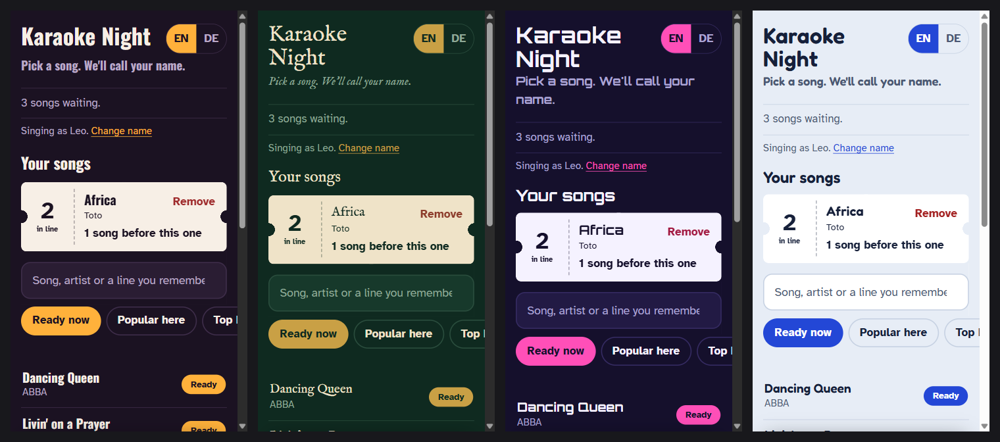

# Pub Karaoke

[](https://github.com/Joshi595/pub-karaoke/actions/workflows/tests.yml)
[](https://github.com/Joshi595/pub-karaoke/actions/workflows/security.yml)
[](https://github.com/Joshi595/pub-karaoke/security/code-scanning)
[](https://scorecard.dev/viewer/?uri=github.com/Joshi595/pub-karaoke)
[](LICENSE)

Free, self-hosted karaoke for bars, cafés, clubs and parties. Guests scan a QR code, pick a song on their phone and join a fair queue. The TV calls each singer up, then plays a proper karaoke screen:

- a backing track made by AI from the original recording
- lyrics that light up word by word, in time with the singing
- quiet help vocals underneath
- a look that matches the song

Nobody has to sit at the laptop.

| The TV | A guest's phone | The staff page |
|---|---|---|
|  |  |  |

## Features

- **Self-service queue.** Guests pick from about 90,000 songs, and the search forgives typos ("bohemain rapsody"), missing accents and word order. The order is fair: whoever has sung least goes next. Staff can skip, reorder and remove from their phone.
- **Songs made on demand.** A song nobody has picked before is made in 2–3 minutes (with an NVIDIA graphics card), before that guest's turn. While the laptop is idle, it makes the songs your venue is likely to want.
- **Lyrics in time.** The song maker listens to the separated vocals and times every word against the singing. Staff can move a song's lyrics earlier or later, and one sync test sets the TV's delay.
- **Your venue's look.** Four looks to choose from (stage, pub, neon, daylight), plus your own name, accent colour, icon and the song lists phones show. Each song also gets its own animated background on the TV.
- **Works on any Wi-Fi.** Phones connect straight to the laptop, or through a free internet link when the Wi-Fi keeps devices apart.
- **Offline once made.** Songs already made play without internet.
- **English and German** on the phones, picked from the phone's language.

## How it works



There are two parts:

- **The live app** serves three pages: the guests' page at `/`, the staff page at `/admin` and the TV at `/tv`.
- **The song maker** turns `Artist - Title` into a karaoke song:
  1. It fetches timed lyrics and downloads the song.
  2. It removes the vocals with AI.
  3. It times every word against the singing.
  4. It picks a look.

## What you need

- A laptop or PC (Windows 10/11, macOS or Linux) connected to the TV over HDMI and to the sound system.
- Disk space: about 5 GB for the song maker, plus about 10 MB per song.
- An NVIDIA graphics card (optional) makes songs in 2–3 minutes. Without one, songs are made on the processor, which is much slower.
- Internet, for new songs.

## Quick start

**Windows:**
1. [Download the code](https://github.com/Joshi595/pub-karaoke/archive/refs/heads/main.zip) and unzip it, or `git clone https://github.com/Joshi595/pub-karaoke.git`.
2. Double-click **`setup.bat`**. It installs anything missing with `winget`: Python 3.12, ffmpeg, Node.js and cloudflared. It then sets up the app, asks whether to install the song maker, and puts a **Pub Karaoke** icon on the desktop.
3. Double-click **Pub Karaoke** on the desktop. The TV shows the welcome screen with the QR code.

**macOS and Linux:**
```
git clone https://github.com/Joshi595/pub-karaoke.git
cd pub-karaoke
./setup.sh      # never uses sudo: it tells you what to install, e.g. brew install ffmpeg node cloudflared
./start.sh      # opens the TV screen full-screen in Chrome or Chromium
```

**First start:** setup creates `settings.json` with a random **staff PIN** and shows it. Write it down, or open `settings.json` in a text editor to read or change it. Staff open `/admin` on their phone and enter it there.

**The full song list:** at first, guests can only find the songs in `starter-songs.txt`. To let them search about 90,000 songs, download the CSV song list from [KaraFun's song list page](https://www.karafun.com/karaoke-song-list.html) and save it as `library/karafuncatalog.csv`, then restart. Download it again now and then for new songs.

## Make it yours

Everything here is on the staff page under **Venue look**, and saved in `settings.json`:

- **Name on the screens:** shown on the TV, the phones and the table cards.
- **Look:**
  - *Stage* (the default): velvet and a spotlight.
  - *Pub*: bottle green and brass.
  - *Neon*: a late-night sign.
  - *Daylight*: bright, for daytime.
- **Accent colour:** your own colour, over any look. Text on it switches between dark and light to stay readable.
- **Icon:** one emoji, shown in browser tabs.
- **Song lists on guests' phones:** choose from Ready now, Popular here, Top hits, Crowd favourites, Irish, German, Schlager, 80s, Rock, Country and Duets.



**`starter-songs.txt`** is the hand-picked list: one `Artist - Title` per line, under `# Crowd favourites`, `# Irish` and `# German`. It fills those three lists and gives the song maker its first batch. The Irish and German sections are examples: edit them for your venue.

To force a look for a song, add it after the title: `Nena - 99 Luftballons | neon80s`. The song looks are `celtic`, `neon80s`, `disco`, `rock`, `ballad`, `pop` and `cover` (colours from the album cover).

## Settings

`settings.json` is created on first start. Staff can change most settings on the staff page; the ones marked *file only* are edited in the file, followed by a restart.

| Setting | Meaning |
|---|---|
| `pin` | Staff PIN for `/admin`. *File only.* |
| `pub_name`, `look`, `accent`, `icon`, `shelves` | Your venue's name and look (see above). |
| `wifi_name`, `wifi_password` | Guest Wi-Fi, shown as a QR code on the TV and table cards. Never sent over the internet link. *File only.* |
| `songs_per_singer` | How many songs one person may have waiting (2). |
| `upnext_seconds` | How long the "get to the mic" countdown runs (15). |
| `max_wait_seconds` | Without the song maker: how long a picked song waits before playing as a YouTube karaoke video (90). |
| `hide_explicit`, `languages` | Hide explicit songs; only show songs in these languages (empty = all). |
| `auto_download`, `library_max_gb` | Make likely songs while idle, up to this much disk (20 GB, about 2,000 songs). |
| `internet_link` | Open the internet link when cloudflared is installed (on). *File only.* |
| `port` | The app's port (5000). *File only.* |
| `public_url` | A fixed address for the QR code, if you run your own reverse proxy. Leave empty otherwise. *File only.* |
| `display` | TV options: lyrics style, highlight, size, position, screen delay. Set on the staff page under *TV screen*. |

## Networks

Phones must reach the laptop. There are two ways.

**The internet link (on by default).** Many venue Wi-Fis keep guests' devices apart, which also keeps phones away from the laptop ("client isolation"). So the app opens a free Cloudflare quick tunnel, and the TV's QR code points to an address like `https://some-words.trycloudflare.com`. That address works from any phone, on the Wi-Fi or on mobile data.
- The address is new every time the app starts, so don't print it: the TV always shows the current one.
- The staff page needs its own PIN over the internet; the default `1234` is refused.
- To switch the internet link off, set `"internet_link": false`.

**The same Wi-Fi.** Phones can also talk to the laptop directly, without the internet:
1. The laptop joins the same Wi-Fi as the guests.
2. Devices on that Wi-Fi must be allowed to reach each other. Routers call this setting "client isolation" or "AP isolation": switch it off for the guest network. (On a FRITZ!Box: *WLAN → Guest Access*, allow the guest devices to communicate with each other.)
3. Give the laptop a fixed address in the router (a DHCP reservation), so printed QR codes keep working.
4. On Windows, allow the app through the firewall, for private networks only, in an administrator terminal:
   ```
   netsh advfirewall firewall add rule name="Pub Karaoke" dir=in action=allow protocol=TCP localport=5000 profile=private
   ```
   If the Wi-Fi shows as *Public* in Windows, switch it to *Private* under *Settings → Network → Wi-Fi*.

## Songs

**Songs are made when someone picks them**, so only the songs your venue wants get downloaded:

1. A guest picks a song that isn't made yet. Within about a second the laptop checks that timed lyrics exist, and puts the guest in the queue.
2. The song maker makes it, always the song that will be sung soonest first. A guest's pick interrupts a song being made in the background.
3. If it isn't ready when that guest's turn comes, the next singer whose song *is* ready goes first, and the guest keeps their place. Their phone and the TV show "Getting your song ready… 60%".
4. A YouTube karaoke video plays only for a song that can't be made: no timed lyrics anywhere (the phone asks the guest first), or no matching recording.

**While the laptop is idle**, it makes songs your venue is likely to want:
- songs picked here before
- more songs by the artists picked here
- the most popular songs in the languages sung here

It stops at the disk limit. Staff can switch this off on the staff page under *Rules*.

**Lyrics in time with the singing.** For every song, the maker listens to the separated vocals, finds where each line is sung, and times each word in it.
- Of several uploads of a song's lyrics, it keeps the one whose lines are heard where they're written.
- A recording that doesn't match the lyrics (a live version, another language) is swapped for another one.
- Each song's `song.json` records how many lines were timed by ear (`"sync": {"aligned": 0.9}`).
- The staff page lists songs whose timing may be off, with *Re-time* and *Delete* buttons.

The song maker from the command line (on macOS/Linux, use `.venv-maker/bin/python`):

```
.venv-maker\Scripts\python make_songs.py                         # the starter list and guests' wishes not made yet
.venv-maker\Scripts\python make_songs.py --prefetch 30           # 30 songs this venue is likely to want
.venv-maker\Scripts\python make_songs.py --only "Queen - Bohemian Rhapsody"
.venv-maker\Scripts\python make_songs.py --retime                # time every song again (about a minute each)
.venv-maker\Scripts\python make_songs.py --remake bonnie-tyler-total-eclipse-of-the-heart   # try other recordings
```

While the app runs, it makes songs by itself. For days it isn't running, schedule a nightly run:
- **Windows** (in a terminal opened in this folder):
  ```
  schtasks /Create /SC DAILY /ST 03:00 /TN PubKaraokeSongMaker /TR "\"%CD%\.venv-maker\Scripts\python.exe\" \"%CD%\make_songs.py\" --prefetch 30"
  ```
- **macOS/Linux:** add a cron line:
  ```
  0 3 * * * cd /path/to/pub-karaoke && .venv-maker/bin/python make_songs.py --prefetch 30
  ```

**Files the app keeps** (all ignored by git):

| File | Contents |
|---|---|
| `library/` | The songs. |
| `history.json` | How often each song was picked here. |
| `catalog-status.json` | Songs that can only play as a karaoke video. |
| `wishes.txt` | Songs typed under *Can't find your song?*. |
| `needs-attention.txt` | Songs the maker couldn't make, and why. |

## On the night

1. Switch on the TV and the sound. If the TV is a *second* screen to the right of the laptop's, set `TV_X=1920` in `start-karaoke.bat` (Windows).
2. Start **Pub Karaoke**. The TV shows the welcome screen with the QR codes.
3. Staff open `/admin` on their phone and enter the PIN. There they can skip singers who don't turn up, let someone go next, turn the help vocals up or down, or move a song's lyrics earlier or later.
4. Print table cards and a staff sheet from `http://localhost:5000/print`.
5. At the end of the night, close the TV screen (Alt+F4) and the server window. A restart within 12 hours keeps the queue; the next night starts fresh.

**Before the first real night:**
- Do the sync test once: staff page → *TV screen* → *Start sync test*, then move *Screen delay* until the flash lands on the click.
- Try a whole round with three phones.
- On Windows, set *Active hours* so updates don't restart the laptop mid-evening, and set sleep to *Never* when plugged in.

## Troubleshooting

| Problem | Fix |
|---|---|
| The TV says "Click to start" | Click the TV screen once with the laptop's mouse, so the browser may play sound. |
| Phones can't open the page | Use the internet link (the default), or see *Networks* for the same Wi-Fi. |
| "Port 5000 is taken" | Pub Karaoke is already running, or another program uses the port (on macOS, AirPlay Receiver). Close it, or set another `port`. |
| New songs fail to download | YouTube changed. Update the downloader: `.venv-maker\Scripts\pip install -U yt-dlp` (and `.venv\Scripts\pip install -U yt-dlp`). |
| Words light up early or late | On the staff page, press *Earlier* or *Later* while the song plays; it's saved for that song. If every song is off, redo the sync test. |
| A song came out badly | Staff page → *Songs* → *Delete*. The next guest who picks it gets it made afresh. |

## Security

Pub Karaoke is built to run on a venue's network with strangers' phones on it. The staff PIN is random and has lockouts, only the laptop can drive the TV, and strict browser security headers are set. Every change is scanned for vulnerabilities. See [SECURITY.md](SECURITY.md) for what's protected, the known limits, and how to report a problem privately.

## Legal

Pub Karaoke is software: it ships no songs, recordings or lyrics. What you do with it is your responsibility, so check before using it in a business:

- **Playing music in public** usually needs a licence from your country's music rights society. Examples: GEMA in Germany (which has a karaoke tariff), PRS for Music / PPL in the UK, ASCAP and BMI in the US.
- **YouTube:** the song maker downloads recordings from YouTube, whose terms allow personal use only.
- **Lyrics:** lyrics from LRCLIB are copyrighted by their authors.
- **The KaraFun song list** is used only as an index of song titles for guests to search. You download it from KaraFun yourself.

This isn't legal advice.

## Development

```
python -m venv .venv
.venv/bin/pip install -r requirements.txt pytest        # on Windows: .venv\Scripts\pip
.venv/bin/python -m pytest -q
```

The tests need no graphics card, songs or network.

| Path | What it is |
|---|---|
| `app.py` | The live app: queue, routes, PIN, internet link. |
| `catalog.py` | Search and song lists. |
| `make_songs.py` | The song maker. |
| `static/` | The pages. `looks.css` holds the four looks; `themes.js` holds the TV's song backgrounds. |
| `test_*.py` | The tests. |

Pull requests are welcome. Please run the tests first.

## Credits

- **Libraries:** [Flask](https://flask.palletsprojects.com), [waitress](https://docs.pylonsproject.org/projects/waitress), [RapidFuzz](https://github.com/rapidfuzz/RapidFuzz), [yt-dlp](https://github.com/yt-dlp/yt-dlp), [python-audio-separator](https://github.com/nomadkaraoke/python-audio-separator) (UVR / Roformer models), [stable-ts](https://github.com/jianfch/stable-ts) (Whisper), [p5.js](https://p5js.org) and [qrcode-generator](https://github.com/kazuhikoarase/qrcode-generator).
- **Data:** lyrics from [LRCLIB](https://lrclib.net); metadata from the iTunes Search API and [MusicBrainz](https://musicbrainz.org).
- **Fonts:** Atkinson Hyperlegible, Oswald, IM FELL English, Orbitron and Fredoka, all under the SIL Open Font License. See [static/vendor/LICENSES.md](static/vendor/LICENSES.md).

## License

[MIT](LICENSE). The bundled third-party files keep their own licenses, listed in [static/vendor/LICENSES.md](static/vendor/LICENSES.md).
